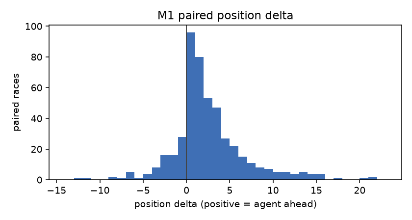
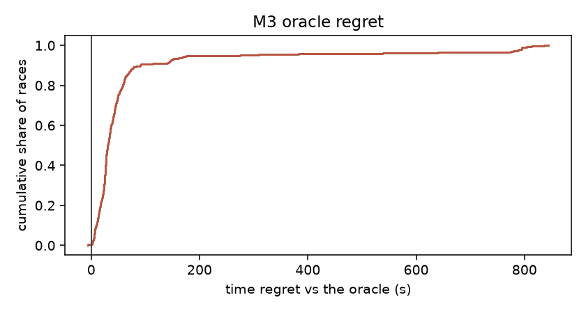
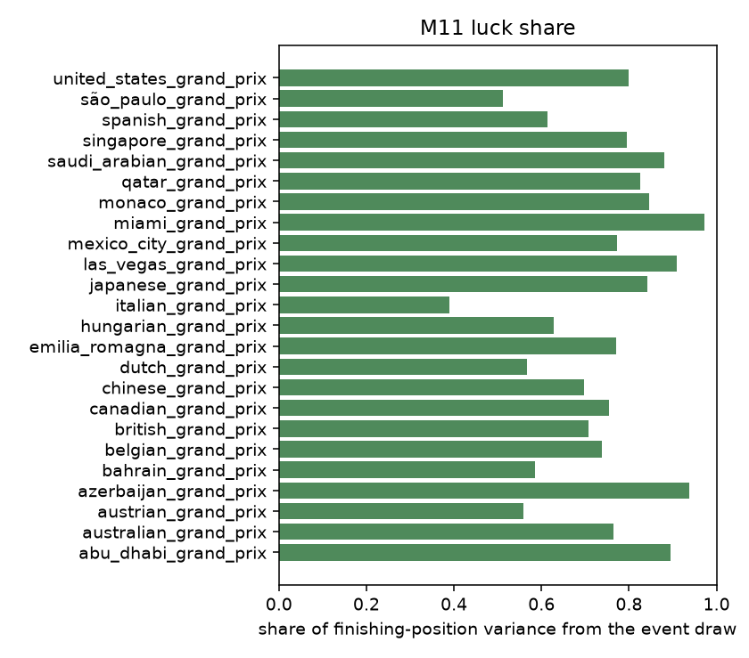

# F14 — the evaluation suite: M1-M11 with confidence intervals

Generated by `make report` from the committed store in `docs/results/F14/store`, which
`make suite` writes. This document is regenerated, never hand-edited: every number below
traces to a stored row carrying the model version, the config hash, the seed manifest
fingerprint and the commit that produced it.

Evaluation runs on held-out ground throughout — the reserved Stage C test seeds (24
circuits x 20, `configs/seeds.yaml`) and the held-out rival band (E-06). Neither is
reachable from training: the seed loader refuses every consumer but this suite, and
`stage_venv` raises on any band but the train one.

## Provenance

| | |
|---|---|
| Models | era2024 `senna-ppo-db031aead155-C-02211840`, headline `senna-ppo-6b6edb78d84e-C-00835584` |
| Env config hash | `6b6edb78d84e` (the training manifest's) |
| Seed manifest | `b112935601b2` |
| Commit | `bccc8a851531` |
| Store | `docs/results/F14/store` |

## How to read these numbers

Pairing is on event traces, not on seeds. The environment consumes randomness in a
policy-dependent way — a tyre only rolls for failure past its cliff, a stop only draws
service time when it happens — so two policies handed the same seed diverge in their events
after the first different stop. Every paired comparison here records one leg's race and
replays both legs through it, which is what makes "identical draws" true rather than
approximately true.

M3, M5 and M6 all ask counterfactual questions of a race that already happened, and all
three answer them on the deterministic twin of that race. The twin freezes the events and
switches off pace noise, so an alternative is priced by its decision rather than by the
luck it happened to meet.

## The metric table (5.12)

| Metric | Value | 95% CI | Target | Verdict |
|---|---|---|---|---|
| M1 paired position delta | 2.083 places over 480 pairs | [1.710, 2.475] | >= +1.0, CI excluding 0 | met |
| M2 counterfactual vs actual | 4W/5L/1T, p=1.000 (mean -0.60 places over 10 races) | [-2.98, 1.76] descriptive | >= +1.0, sign test p < 0.05 | **miss** |
| M3 oracle regret | median 33.09 s (mean 86.98 s, 480 races) | p05 4.01 / p95 313.16 | report distribution | reported |
| M4 energy utilisation | 0.649 deployed/E_dep (ceiling 0.914, 0.710 of attainable), derates 0.080 of green laps | - | >= 0.9 and derates <= 0.05 | **miss** |
| M5 SC decision quality | precision 0.942, recall 0.308 over 374 windows | - | both >= 0.75 | **miss** |
| M5 VSC decision quality | precision undefined, recall 0.000 over 300 windows | - | both >= 0.75 | **miss** |
| M6 pit window accuracy | 0.228 of 457 stops | [0.190, 0.267] | >= 0.72 | **miss** |
| M7 strategy diversity | 0.226 nats mean over 24 circuits | - | report only | reported |
| M8 sim-to-real | 0/4 circuits within KS 0.15, worst 0.946 | held-out rounds 7+ | KS < 0.15 per circuit | **miss** |
| M9 tyre failure rate | 37.29 per 100 races (179/480) | - | < 2.0 | **miss** |
| M10 regulatory legality | 0 coerced actions, 0 snapped over 480 races | - | 0 by construction | met |
| M11 luck share | 0.758 of finishing-position variance | [0.679, 0.820] | report only | reported |

## How each metric can be gamed or misread

**M1.** Weak rivals inflate it. Rivals are fitted to data and evaluation uses the held-out rival band (E-06); the scripted baselines are also scored against that band so opponent difficulty is separable from the agent's own gap. Also reported against replayed-real strategies (M2).

**M10.** Nothing to game — that is the point of moving compliance out of the reward (F-16). The standing 100k-random-action property test covers the action space; this row covers the other half of the claim, that no eval log contains a coerced or illegal executed action.

**M11.** It depends on event-model realism, so the per-circuit event rates are validated first (5.4.1). Two honest caveats ride with the number. The served policy is deterministic, so the split only exists under some decision distribution and the natural one is the policy's own head — mean head entropy is reported alongside for context. And because the env consumes randomness policy-dependently, re-sampled decisions also shift the events they meet; that entangled variance is charged to the decision side, which makes the published luck share a conservative lower bound on what the event draws explain.

**M2.** Sim optimism: the agent optimised the very simulator it is scored in, while the real teams optimised reality. Framed as an in-simulator counterfactual under stated assumptions and read alongside the M8 sim-to-real error. The replay baseline's snapped-stop count is reported with it — a strategy the mask had to alter is a weaker comparison.

**M3.** An easy oracle flatters the agent. The oracle's search space and its seven assumptions are published verbatim with the distribution (senna/strategy/oracle.py), the agent's own realised plan is entered as a contender so the oracle can only tie or beat it on the pit dimension, and negative regrets are reported rather than clipped — they are the greedy-energy assumption showing, not a bug.

**M4.** Trivially maxed by always attacking, so it is only meaningful jointly with M1/M2 and is always printed as a pair with the derate rate. Green laps only: deployment under a neutralisation is not a strategic choice.

**M5.** Always-pit inflates recall, so precision is reported jointly and VSC and SC are kept apart (E-03) because they are different opportunities. The denominator is published: one decision opportunity is one neutralisation window offering at least one informed in-window decision lap. A pit on the onset lap was decided before the neutralisation was visible and is not counted as a call. The ex-post label is policy-dependent — alternatives continue under the agent's own policy — so an agent that follows a stop up badly partly excuses its own stay-out calls; that is stated, not corrected.

**M6.** The optimum depends on the search's information set, so the information set is stated: a post-hoc, coordinate-wise argmin over feasible laps for one stop on the frozen event trace, holding the other stops, the compound sequence and the energy actions fixed. The agent decided with no future event knowledge; the search sees the whole race. The 3-lap tolerance is the allowance for that asymmetry. Reactive pitting the lap after a neutralisation scores well here, so read it with M5.

**M7.** Dithering fakes diversity, so this is a sanity metric and never a headline. v2's 2.1-nat target was dropped as arbitrary; the entropy is reported per circuit with its stop-count and first-compound histogram so the shape is visible, not just the scalar.

**M8.** Calibrating on the test rounds would make this circular, so the split was frozen before any fitting (E-14, configs/data_split.yaml): rounds 1-6 calibrate, 7+ are held out and read only through senna/physics/synth/heldout.py. The pit-loss comparison is a definition gap as much as a model gap — the simulated number is net pit loss, the real number is OpenF1 stationary duration — and a near miss should be read that way.

**M9.** Trivially zero by never stretching a stint, so it is read jointly with M1 and the stint-length distribution, both of which are reported beside it.

The overlay studies below mutate a config on purpose, so each prints its own hash beside its table.

## Harvest-cap sensitivity (E-02)

The FIA refined the maximum permitted recharge to 7.0 MJ (2026
Technical Regulations Issue 18, Art C5.2.10). The frozen model trained at the
8.5 MJ baseline and every number above is measured there, because
moving the value in `configs/circuits.yaml` would desync the fingerprint the
served triplet records. The refined figure runs as an eval-only overlay on the
same seeds instead — both arms are built the same way, so the only difference
between them is the number in the yaml.

| Cap | Utilisation | Derate share | Mean finish |
|---|---|---|---|
| trained (8.5 MJ) | 0.648 | 0.078 | P4.81 |
| refined (7.0 MJ) | 0.627 | 0.182 | P4.94 |

Tightening the cap costs 0.13 places on average while the derate share moves +0.104: the agent runs out of energy more often, which is what operating closer to a limit looks like. Read this as the frozen agent's robustness under a 7.0 MJ cap, not what a model re-optimised for 7.0 MJ would do — the reported numbers stay on the 8.5 MJ cap it trained under.

Provenance: config `26a436fece3d` (circuits.yaml, the base file the overlays scaled), seeds `b112935601b2`.

## M2 energy-coefficient sensitivity

The 2024 counterfactual scenario borrows the 2026 fitted energy-mode block
(`configs/physics_2024.yaml` names the four coefficients). Both arms re-roll
the ten M2 races with that block scaled by +/-50% under the era-matched model.

| Arm | Mean delta (places) | Races |
|---|---|---|
| up (+50%) | -0.14 | 10 |
| down (-50%) | -0.52 | 10 |

Read this as the borrowed 2026 energy-mode fit scaled by +/-50% under the era-matched model — how much of M2 rides on coefficients the 2024 era never fitted, not a claim about either era's true physics.

Provenance: config `d507c0d6fc35` (the base configs the overlays scaled), seeds `b112935601b2`.

## Figures

## Reproducing this

    make suite            # rolls every battery, rewrites the committed store
    make sensitivity      # the E-02 harvest-cap pass this document's last section reads
    make report           # regenerates this document and its figures

`make report` reads only the committed store, so it needs no model, no database and
no GPU. `make suite` needs the frozen triplet in `models/headline` and, for the
era-matched counterfactuals, `models/era2024` from `make finetune`.

A retrain invalidates every number here by construction (E-15): the store's rows
carry the model version they were produced against, and a new checkpoint means a
new suite run.
